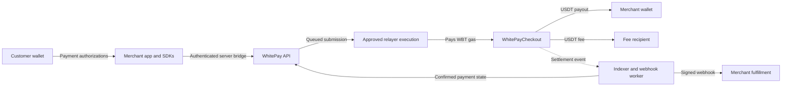

# WhitePay

**USDT checkout on Whitechain. Gas paid by a relayer.**

WhitePay gives merchants a checkout API, a React payment widget, and signed webhooks for accepting official USDT on **Whitechain Sepolia**. Customers authorize the payment with their wallet and can hold **zero WBT**. A separately funded relayer pays the network gas, and the checkout contract atomically distributes the merchant payment and sponsorship fee.

[Website](https://whitepay-website.vercel.app) · [Demo SaaS](https://whitepay-saas.onrender.com) · [Documentation](https://whitepay-docs.vercel.app) · [Pitch deck](https://whitepay-website.vercel.app/pitch) · [On-chain payment](https://explorer.testnet.whitechain.io/tx/0x77784da3835084852e0f3904ba6845011725ffade891175b4b4a96d93948b41c)

> **Public alpha · Testnet only.** WhitePay uses test assets, not real-dollar USDT. The hosted SaaS and PostgreSQL storage are deployed; merchant configuration, hosted worker/webhook delivery, and a live purchase through that hosted SaaS remain in progress. Earlier approved checkout payments have been verified on-chain.

## What WhitePay provides

- **Gas-sponsored checkout:** customers pay official USDT while the relayer covers WBT gas.
- **Signed payment terms:** EIP-712 orders bind the payer, merchant, token, amount, fee, recipient, and authorization window.
- **Atomic settlement:** merchant and fee payouts succeed together or roll back together.
- **Replay protection:** order consumption is scoped to the payer, alongside the token's authorization protections.
- **Merchant APIs:** authenticated checkout sessions, immutable price versions, idempotent requests, and payment status retrieval.
- **Verified fulfillment:** an indexer reconciles confirmed settlement and queues signed webhook delivery. Merchant apps grant purchases only after verifying delivery and payment state.
- **Published SDKs:** Node.js server integration and a React checkout widget, both available on npm as public alpha releases.

## Live applications

| Application               | URL                                                                | Current status                                                                             |
| ------------------------- | ------------------------------------------------------------------ | ------------------------------------------------------------------------------------------ |
| Website and payment proof | [whitepay-website.vercel.app](https://whitepay-website.vercel.app) | Live; includes a clearly labelled historical receipt walkthrough                           |
| Forma demo SaaS           | [whitepay-saas.onrender.com](https://whitepay-saas.onrender.com)   | Live UI, customer sessions, and Postgres storage; payment configuration is being completed |
| Merchant API              | [whitepay-api.onrender.com](https://whitepay-api.onrender.com)     | Live; health and database readiness verified with five migrations                          |
| Developer documentation   | [whitepay-docs.vercel.app](https://whitepay-docs.vercel.app)       | Live SDK guides, architecture, examples, and limitations                                   |
| Pitch deck                | [View slides](https://whitepay-website.vercel.app/pitch)           | Eight-slide web presentation with PDF download                                             |

The Forma SaaS sells **100 credits for 5 USDT**, plus a disclosed **0.005-USDT sponsorship fee**: **5.005 USDT total**. Its sample action spends one credit in the database; it does not call a paid AI service.

The live API exposes [liveness](https://whitepay-api.onrender.com/health) and [database readiness](https://whitepay-api.onrender.com/ready). Merchant endpoints require a server-side API key. Installing an SDK does not provision a merchant account or an executing relayer.

## How a payment works



1. The merchant server creates a checkout session for a configured price.
2. The customer reviews the price, sponsorship fee, total, network, and expiry.
3. The wallet signs the checkout order and token authorization.
4. The relayer validates the submission and submits the settlement transaction using its own WBT.
5. The contract executes the exact USDT split atomically.
6. The worker indexes the confirmed receipt and delivers a signed webhook. The merchant verifies the payment before delivering the purchase once.

The operator-controlled execution path has been used for approved testnet payments. An unattended hosted signer is not part of the current deployment.

## Network and on-chain evidence

| Setting                 | Value                                                                                                                                     |
| ----------------------- | ----------------------------------------------------------------------------------------------------------------------------------------- |
| Network                 | Whitechain Sepolia                                                                                                                        |
| Chain ID                | `1874`                                                                                                                                    |
| RPC                     | `https://rpc.testnet.whitechain.io`                                                                                                       |
| Official test USDT      | [`0xcedfB56113143d55b2358b8CFbB0dEB5Ad2f55a7`](https://explorer.testnet.whitechain.io/address/0xcedfB56113143d55b2358b8CFbB0dEB5Ad2f55a7) |
| Token decimals          | `6`                                                                                                                                       |
| Final checkout contract | [`0x4d1761ABB4eD290F23fcDA00890039800E2e53f0`](https://explorer.testnet.whitechain.io/address/0x4d1761ABB4eD290F23fcDA00890039800E2e53f0) |

A verified React widget payment delivered **1 USDT** to the merchant and **0.001 USDT** to the fee recipient, with the payer's WBT balance remaining **zero**. [View the transaction](https://explorer.testnet.whitechain.io/tx/0x77784da3835084852e0f3904ba6845011725ffade891175b4b4a96d93948b41c) and [Step 09 evidence](docs/progress/step-09.md).

This payment is separate from the pending hosted Forma purchase. Final-contract deployment and replay checks are recorded in [Step 04](docs/progress/step-04.md); explorer source verification remains open in the project evidence.

## SDK installation

Pin the current alpha versions explicitly:

```sh
# Merchant server
npm install @whitepay/node@0.1.0-alpha.0

# React checkout
npm install @whitepay/react@0.1.0-alpha.0 react react-dom
```

| Package           | Purpose                                                                    | Resources                                                                                           |
| ----------------- | -------------------------------------------------------------------------- | --------------------------------------------------------------------------------------------------- |
| `@whitepay/node`  | Server-side API client, checkout bridge, and webhook verification          | [npm](https://www.npmjs.com/package/@whitepay/node/v/0.1.0-alpha.0) · [Source](packages/sdk-node)   |
| `@whitepay/react` | Wallet authorization, checkout review, status polling, and receipt display | [npm](https://www.npmjs.com/package/@whitepay/react/v/0.1.0-alpha.0) · [Source](packages/sdk-react) |

Start with the [quickstart](https://whitepay-docs.vercel.app/quickstart), [server integration](https://whitepay-docs.vercel.app/server), and [webhook guide](https://whitepay-docs.vercel.app/webhooks). API keys and webhook signing secrets belong on the merchant server. Fulfillment must not depend on a browser success callback.

## Repository structure

```text
apps/
  demo-saas/       Forma credits workspace and merchant integration
  demo-shop/       Independent digital-download merchant demo
  dashboard/       Merchant dashboard prototype
  docs/            SDK documentation site
  website/         Landing page, payment proof, and pitch deck
packages/
  contracts/       Checkout contract, experimental PoC, and Foundry tests
  chain/           Whitechain reader and transaction adapter
  sdk-node/        Published Node.js SDK
  sdk-react/       Published React checkout widget
  shared/          Shared types and utilities
services/
  api/             PostgreSQL-backed merchant and checkout API
  relayer/         Validation, simulation, and operator execution tooling
  worker/          Receipt indexing, reconciliation, and signed webhooks
```

## Local development

### Prerequisites

- **Node.js 24 LTS** and **pnpm 10.25.0**. The repository supports Node `>=24 <26`.
- **PostgreSQL 15+** for API, relayer, worker, and Postgres integration tests.
- **Foundry** (`forge`, `cast`, and `anvil`) for contract and chain-adapter work.
- **Chrome or Playwright Chromium** for browser acceptance checks.

```sh
git clone https://github.com/anumukul/WhitePay.git
cd WhitePay
pnpm install --frozen-lockfile --ignore-scripts

# Build the workspace SDKs before running the merchant applications.
pnpm --filter @whitepay/node build
pnpm --filter @whitepay/react build
```

Each application has its own configuration. Use the relevant `.env.example` and application README; keep credentials in ignored environment files or hosting settings. The API does not load the root `.env` automatically.

### Start the local API

With PostgreSQL binaries available on `PATH`, the development helper starts a dedicated loopback-only cluster at port `55432`. It uses `/private/tmp`, so it targets the documented macOS/local Unix setup. Other environments can supply their own dedicated Postgres database.

```sh
pnpm db:local
export DATABASE_URL=postgresql://whitepay_test@127.0.0.1:55432/whitepay_step05
export TEST_DATABASE_URL="$DATABASE_URL"

# Starts the API on 127.0.0.1:3001 and applies its migrations.
pnpm --filter @whitepay/api dev
```

See the [API runbook](docs/runbooks/step-05-api.md) for merchant provisioning and complete quote configuration. Hosted deployments use the final checkout address above, chain `1874`, a configured fee recipient, and the intended merchant origin.

### Run an application

Run each command in its own terminal after configuring that application:

```sh
pnpm --filter @whitepay/demo-saas dev  # http://localhost:3300
pnpm --filter @whitepay/docs dev       # http://localhost:3400
pnpm --filter @whitepay/website dev    # http://localhost:3500
```

For hosted Forma storage, set `DEMO_DATABASE_URL`. Its orders, entitlements, and credit ledger use the separate `whitepay_saas` Postgres schema. Development can use SQLite; production rejects an implicit SQLite fallback. See [the SaaS setup guide](apps/demo-saas/README.md) and [the shop setup guide](apps/demo-shop/README.md) for the independent integrations.

## Verification

Use a disposable local database for tests. Contract fork tests use pinned chain state and do not broadcast transactions.

```sh
# Root checks
pnpm test
pnpm typecheck

# Final checkout and official-token fork tests
bash scripts/vendor-oz.sh
pnpm test:checkout
pnpm test:checkout:fork

# Postgres-backed API and SaaS checks (TEST_DATABASE_URL must be set)
pnpm --filter @whitepay/api test
pnpm --filter @whitepay/demo-saas test

# Build and exercise the merchant checkout in Chrome
pnpm --filter @whitepay/demo-saas build
pnpm --filter @whitepay/demo-saas test:browser
```

Recorded verification includes the API's **53 passing tests**, the SaaS's **9 fulfillment/Postgres tests**, and its **Chrome checkout test** covering signed webhook delivery, duplicate rejection, spending, and customer isolation. The redesign also has desktop/mobile checks across the overview, pack, payment, and balance views. These are scoped checks, not a fresh certification of every workspace package.

Browser receipt fixtures are controlled test data. Actual on-chain settlements are linked separately above. Detailed results are in the [API report](docs/progress/step-13.md), [SaaS report](docs/progress/step-11.md), and [SDK release report](docs/progress/step-14.md).

## Current limitations

- Hosted merchant provisioning, indexer/webhook delivery, and a live Forma purchase still need completion.
- The relayer requires WBT funding and approved execution. There is no deployed unattended signing service.
- The merchant dashboard is a prototype; full merchant onboarding and management remain incomplete. The digital shop is implemented locally and is not publicly deployed.
- Public alpha APIs and SDKs may change. This testnet deployment is not presented as an independently audited production payment service.
- The current free hosting setup has operational limits: Render web services can sleep, and Free Postgres expires after 30 days. See [Render's free-service documentation](https://render.com/docs/free).
- Wallet compatibility, token restrictions, source verification, and release gaps are documented in [limitations](docs/limitations.md) and [security](docs/security.md).

## Further reading

- [Architecture](docs/architecture.md) · [Threat model](docs/threat-model.md) · [Security](docs/security.md)
- [Implementation reports](docs/progress) · [Operational runbooks](docs/runbooks)
- [Contract deployment](docs/runbooks/step-04-deploy.md) · [Service deployment](docs/runbooks/step-13-deploy.md)
- [SDK publishing](docs/runbooks/step-14-publish.md) · [Demo script](docs/demo-script.md)

The published SDK packages use the MIT license; see the [Node SDK license](packages/sdk-node/LICENSE) and [React SDK license](packages/sdk-react/LICENSE).
